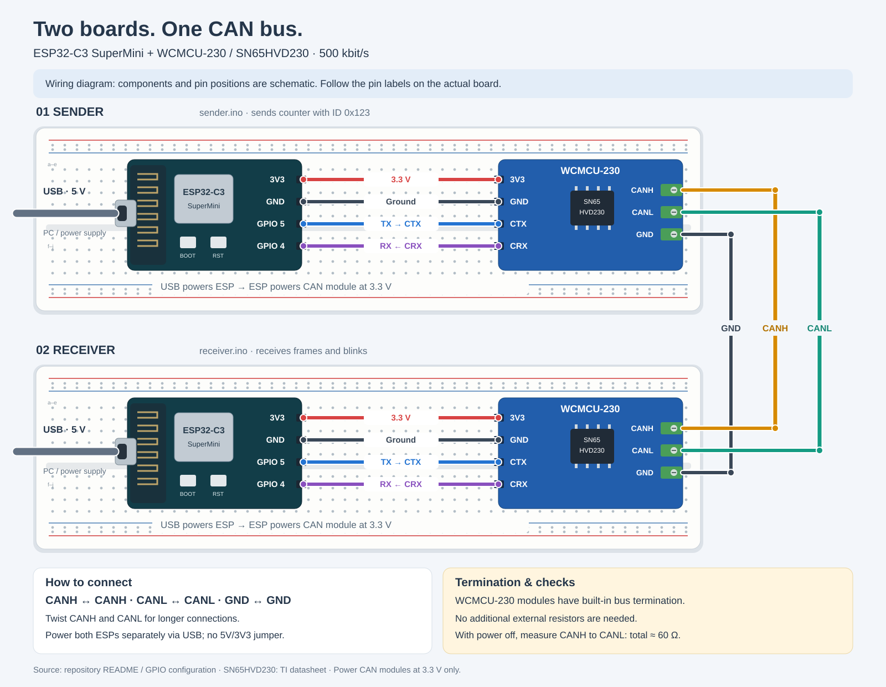

# example-canbus

Minimal CAN bus demo with two **ESP32-C3 SuperMini** boards and two **WCMCU-230** modules (SN65HVD230 transceivers).
The ESP32-C3 includes the CAN controller (TWAI); the WCMCU-230 only converts the signals to bus levels.

> An ESP8266 (e.g. D1 mini) has **no** CAN controller and cannot be used this way.

## Hardware

- 2x ESP32-C3 SuperMini (solder the pin headers)
- 2x WCMCU-230 (3.3 V, usually with 120-ohm termination already fitted)
- Breadboard, jumper wires

## Wiring (identical on both sides)

| ESP32-C3 | WCMCU-230 |
|---|---|
| 3V3 | 3V3 |
| GND | GND |
| GPIO 5 | CTX |
| GPIO 4 | CRX |

Bus connections between the modules: `CANH-CANH`, `CANL-CANL`, `GND-GND`.

### Breadboard wiring diagram



[Download SVG](docs/canbus-breadboard.svg) · [PNG preview](docs/canbus-breadboard.png)

[Open the interactive breadboard diagram in Wokwi](https://wokwi.com/projects/478383260674919425)

The Wokwi diagram shows normal operation with both ESPs and CAN modules on
breadboards, connected by colored jumper wires. Virtual ESP32-C3 DevKit boards
stand in for the SuperMini boards: actual pin positions and breadboard rows
differ. Connect by GPIO numbers and module labels. The diagram is a wiring aid,
not an electrical CAN simulation. No CTX-GND test jumper may be fitted during
normal operation.

The drawing shows both ESPs with separate USB power supplies. Components and
pin positions are schematic: follow the labels on the actual board when wiring.
Each CAN transceiver is powered at 3.3 V by its own ESP.
Each bus end requires 120 ohms between CANH and CANL; count any termination
resistors already fitted to the modules and do not add duplicates.

```
 C3 #1 -- WCMCU #1                 WCMCU #2 -- C3 #2
           CANH ------------------- CANH
           CANL ------------------- CANL
           GND  ------------------- GND
```

### Verified hardware test on October 20, 2026

Two ESP32-C3 SuperMini boards, each with a WCMCU-230, were tested with separate
USB power supplies and no 5V jumper. For each module: ESP-3V3 to 3V3,
ESP-GND to GND, GPIO 5 to CTX and GPIO 4 to CRX. Between the modules,
CANH connects to CANH, CANL to CANL and GND to GND. Both existing
120-ohm module terminations remain fitted; no additional terminations.

| Check | Result |
|---|---|
| Controlled single transmission at 500 kbit/s | Received in both directions and acknowledged with ACK; error counters zero |
| Controlled single transmission at 125 kbit/s | Received in both directions and acknowledged with ACK; error counters zero |
| Normal operation at 500 kbit/s | 23 consecutive frames at the receiver, counters 13 through 35 without gaps, 23 ACK messages, no observed bus errors |

After testing, the normal sender and receiver programs at 500 kbit/s were
flashed again. The roughly 23-second observation is a functional test,
not proof of long-term interference-free operation. The 125 kbit/s check
was a single test in each direction, not an endurance run.

Troubleshooting revealed a missing ground connection. Earlier failed attempts
therefore do not prove a module defect. The manual sustained test with CTX
connected to GND is also not a reliable defect indicator here: despite the
absence of a sustained bus differential, short pulses were reported and CAN
frames were transmitted successfully. GPIO sampling showed RX returning high
after roughly 100 to 300 microseconds while TX remained low;
the cause of this behavior was not conclusively determined.

### Power supply

- Verified setup: power both ESPs separately via USB, with no 5V jumper.
- Optional: power only board #1 via USB and bridge 5V and GND to board #2.
- Disconnect the 5V jumper when flashing (to prevent backfeeding).
- Never connect 3V3 to 3V3 between boards. Never power the WCMCU-230 at 5 V.

## Browser debugging (without Arduino IDE)

[Open CAN/LAB online](https://vergissberlin.github.io/example-canbus/debug/)

The local [CAN/LAB console](debug/index.html) reads USB output from sketches
already flashed onto the boards. It can open both boards simultaneously,
show RX counters and counter gaps, and filter, pause and export logs as text.
Reading existing logs requires no firmware changes;
the adjustable load test requires both current sketches.

The console supports English firmware logs only. Flash the current sketches
onto both boards before using it.

1. Run `./debug/serve.command` from the repository (on macOS, double-clicking also works).
2. Open **http://localhost:8765/debug/** in **Microsoft Edge or Google Chrome**
   on your Mac. The browser must support Web Serial.
3. Connect both ESPs via USB; with separate USB power supplies, do not fit a 5V
   jumper between the boards. Close other serial monitors.
4. Click **Connect USB** for each board and grant access to its port.
   For identical devices, first plug in and connect only the receiver,
   then plug in and connect the sender.
5. If there is no output, briefly press **RESET without BOOT** on the relevant
   board. Increasing `RX ID 0x123` counters confirm CAN communication;
   `TX … ok` only confirms queueing at the sender.

Recording stays in the browser; at most 2,000 log lines are stored.
“Pause display” only pauses rendering; recording and measurements continue.
“Clear” removes log lines while keeping measurements. Reloading the page closes
connections and resets logs and measurements. Counter gaps can also result
from missing USB log lines and do not prove CAN packet loss.
Stop the server with `Ctrl+C`.

### Install as a PWA

CAN/LAB can be installed from the [GitHub Page](https://vergissberlin.github.io/example-canbus/debug/).
In Chrome or Edge on a supported desktop or Android device, use the browser's
**Install app** action. On iPhone or iPad, open the page in Safari and choose
**Share → Add to Home Screen**. The app opens in its own window with a matching
icon and startup screen.

After the first successful online visit, the console, control logic and wiring
diagrams remain available offline. USB connections and recorded logs stay in the
current browser session and are not stored in the offline cache. Close all app
windows and tabs, then reopen the app to activate a downloaded service-worker
update; an active USB session is never reloaded automatically.

Installation does not add Web Serial support to a browser. Safari on iOS/iPadOS
can display the app and diagrams but cannot connect to these USB boards through
Web Serial. Use a browser and operating system that support Web Serial for USB
debugging and hardware load tests.

The PWA includes regular and maskable Android/desktop icons, Apple touch icons,
Windows tiles, favicons, and portrait/landscape Apple startup images for 23 phone
and tablet screen profiles. Android and desktop browsers generate their launch
screens from the manifest icon and colors.

The master logo is `pwa/logo.png`. To regenerate all device images and their HTML
links, run `python3 scripts/generate_pwa_assets.py` with ImageMagick 7 and the
DejaVu Sans fonts installed. Build the deployable site with
`python3 scripts/build_site.py`; output goes to the ignored `_site/` directory.
The build versions the service-worker cache from the published files. GitHub
Pages runs the same build automatically after relevant changes reach `main`.

### Adjustable CAN load test

The **“How much gets through?”** panel controls the sender via Web Serial:

1. Flash both current sketches again (commands under “Flashing with PlatformIO”).
   Older demo firmware and dedicated self-test firmware do not support the control commands.
2. Connect both boards using the correct USB cards. The firmware handshake checks
   the role, protocol version and shared bitrate of **500 kbit/s**.
3. Choose a target rate between **1 and 20,000 frames/s** and a test duration
   between **1 and 60 seconds**. Start with, for example, 100 frames/s for ten seconds.
4. **Start test** stops the normal one-frame-per-second demo, prepares the receiver
   and starts the sender only after the receiver acknowledges readiness.
5. During the test, **Apply rate** changes the target rate while keeping the original
   end time. **Stop** ends queueing. The firmware stops automatically when time
   expires, even without an open browser. A frame already being transmitted may
   still complete.
6. After the test, the sender remains stopped. RESET on the sender restarts
   the normal demo at one frame per second.

Load frames use standard ID `0x123` and **eight data bytes**: a four-byte counter
and a four-byte test ID, both little endian. The normal demo still uses four
data bytes. The bitrate is not changed here. The target rate is offered load
and may exceed bus capacity.

**What the readings mean:**

- **Received/FPS:** Frames for this test counted by the receiver within its
  firmware measurement window; not an estimate based on USB arrival times.
- **Queued/FPS:** Frames successfully handed to the sender's TWAI transmit queue.
  This does not prove reception at the other end.
- **TX queue full / rejected:** Transmit attempts that were not accepted. The
  payload counter is not incremented for these attempts, so they do not create
  artificial reception gaps.
- **Scheduler skipped:** Transmission opportunities not caught up after a program
  interruption. The firmware limits catch-up bursts to 32 frames.
- **Counter gaps:** Missing sequence values detected in matching test payloads.
  Missing final frames cannot be detected by this alone.
- **RX queue full / HW overrun** and **Bus errors sender / receiver:** Separate
  TWAI error counters relative to the start of this test. They do not measure
  electrical bus utilization or automatically give a loss rate.

The time chart shows the last 60 seconds on an axis in seconds: a blue dashed
line for frames/s queued for transmission and a green line for frames/s actually
received. TX does not confirm successful transmission. Points show the roughly
one-second firmware measurement windows at their device elapsed time; exact
per-second counts and missing values are not interpolated. Longer reporting gaps
break the line. Hover over a point for measurement time and rate. The slider
uses increments of five (5–20,000); 1 frame/s remains available through the preset
and number field. Previous measurements stay visible after the test ends.
Starting a new test resets them. After more than three seconds without a new
report, the display is marked stale. Pausing or filtering the console affects
neither measurements nor control commands.

The receiver runs without the previous 50-ms pause per frame. Load frames are
not logged individually over serial; both boards report totals roughly once per
second. This is intended to keep the USB console from limiting the test itself.
The signal-path diagram pulses when these summary reports arrive; it does not
show precisely timed individual pulses on the CAN bus.

Commands are sent with a newline at 115200 baud:

```text
LAB HELLO
LAB STOP
LAB ARM 123
LAB START 123 1000 10
LAB RATE 123 5000
LAB STATUS
LAB STOP
```

`ARM` is for the receiver; `START` and `RATE` are for the sender. The test ID
must match on both sides and must be nonzero. `START` contains the ID, target
rate and duration in seconds. Invalid values are rejected. The browser page
uses a new ID for each start and waits for ACKs.
Use only in this isolated breadboard experiment.

**Validation status:** JavaScript protocol and state tests, native C++ tests of
the command parser and pacing, and both PlatformIO builds have been checked
locally. All 35 JavaScript tests and 18 browser integration tests pass; the native
C++ test and both PlatformIO builds also succeed. The browser test page explicitly
uses simulated USB ports. Hardware acceptance testing of the adjustable rate
for this new load-test firmware is still pending, because no ESPs were connected
via USB at completion. The successful hardware tests described above apply
to the previous demo version.

### Live signal path

The additional [communication SVG](docs/canbus-communication.svg) above the
WebSerial console shows both ESPs and CAN modules. Pin positions are schematic;
the complete breadboard diagram remains available above.

- **TX queued:** GPIO 5 → CTX on the relevant board flashes blue.
  This does not yet confirm reception.
- **RX detected:** CANH/CANL and CRX → GPIO 4 on the receiving board flash.
  The diagram shows the last CAN ID, counter if available, and RX log age.
- **USB log data:** The relevant ESP's USB wire pulses on serial data,
  including waiting and error messages. This alone does not confirm CAN reception.
- **Error / Bus-Off:** The affected ESP is marked red.
  The mark clears on new RX reception or a new USB connection.

The display is based on USB logs, not electrical measurements. ACKs and electrical
transmission timing are not simulated. Power and GND remain static. The 400-ms
highlights run independently of log filters and console pausing; rapid events
are combined without queueing animations. Disconnecting clears the board's active
highlights. With reduced motion, a fixed color highlight replaces animation.
On small screens, the diagram scrolls horizontally.
If the SVG cannot be loaded, WebSerial continues to work.

### Tests

Parser, signal and load-control tests: `node --test debug/*.test.mjs`.

Native firmware control tests:

```sh
c++ -std=c++11 -Wall -Wextra -Werror tests/load_control_test.cpp -o /tmp/canlab-control-test
/tmp/canlab-control-test
```

For browser integration tests, start the local server, open
http://localhost:8765/debug/communication.browser.test.html and click **Run tests**.
The clearly labeled test page uses virtual USB ports in an isolated iframe and
checks TX/RX, pause/filter behavior, event sequences, errors, disconnecting,
mobile layout, the reduced-motion rule and SVG load failure. It does not confirm
real CAN reception or change hardware connections on the normal debug page.

## Flashing with PlatformIO

### Separate hardware self-test

`pio run -c diagnostics.ini -e diagnostics -t upload --upload-port PORT` flashes
the dedicated test firmware onto one board. It starts with the CAN controller
disabled and holds CTX at the recessive level. The test firmware temporarily
replaces the sender or receiver; for normal operation, flash the relevant sketch
again using the commands below.

Serial commands at 115200 baud, each followed by a newline: `quiet` disables
TWAI; `self500` and `self125` each check local self-reception five times at
500 or 125 kbit/s without requiring an ACK. The other end must be `quiet`.
While CANH/CANL remain connected, a shared bus fault may also affect these local
tests; failure does not prove a defective chip.
`normal500`/`normal125` enable normal reception at the same bitrate on both boards;
`send` transmits a single test frame without retrying; `status` shows error
counters. Only an RX frame at the other end confirms network reception;
self-reception is explicitly logged as `PROBE SELF`.

`internal` runs five control attempts at 500 kbit/s, looping the TX pad back
through the GPIO matrix. This bypasses the transceiver and GPIO4; success does
not prove the external signal path works. With TWAI stopped, `levels` briefly
toggles GPIO5 HIGH/LOW five times and reads GPIO4 with a pull-up. This test is
intended for the isolated breadboard setup with CANH/CANL connections disconnected,
not for a connected production CAN bus. The firmware returns to the quiet state
after these tests.

```sh
# Sender
pio run -e sender -t upload

# Receiver
pio run -c receiver.ini -e receiver -t upload
```

## Usage (Arduino IDE)

1. Board: *ESP32C3 Dev Module*, **USB CDC On Boot: Enabled**.
2. Flash `sender/sender.ino` onto board #1 and `receiver/receiver.ino` onto board #2.
3. Open Serial Monitor (115200 baud).

## Troubleshooting

- The diagnostic firmware outputs `DIAG` lines with the driver state (`0` stopped,
  `1` active, `2` Bus-Off, `3` Recovery), error counters and sampled RX level.
  This instantaneous level is not a voltage measurement and does not prove the
  line is continuously quiet. `TX_ACK=1` indicates a TX_SUCCESS alert from the
  controller; only the receiver application's RX log confirms reception there.
- After Bus-Off, the sender starts recovery and then restarts the driver.
- If the sender reports Bus-Off and the receiver sees no frames, check for about
  3.3 V directly between `3V3` and `GND` on each powered CAN module.
- With power disconnected, measure between CANH and CANL: about **60 ohms**
  (two terminations in parallel).
- `TX … ERROR (peer/wiring?)`: no other node, CANH/CANL swapped or mismatched bitrate.
- Both sketches use a bitrate of 500 kbit/s.
- GPIO 2, 8 and 9 are strapping pins; do not use them for CAN.
